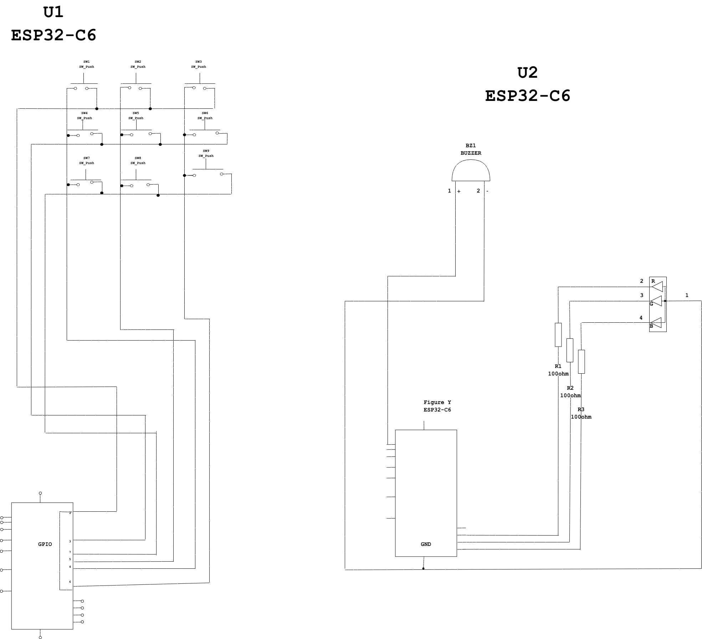

# Project: button-matrix-lock-system

## Overview

An embedded systems project using two ESP32-C6 MCUs & Arduino IoT Cloud.
The project shows two seperate microcontrollers can communnicate to create basic combination lock with both visual and audio feedback

It consist of two devices:
- **Input Device:** Uses 3x3 button matrix to detect input, validate password and manage the lock state
- **Output Device:** Uses RGB LED and a buzzer to provide visual and audio feedback based on the current state of the system

The two communicate through Arduino IoT Cloud, making input device to send changes on the system state to the output device.

System support three states:
- **LOCKED**: Blue breathing LED light shows the device being locked
- **UNLOCKED**: Green solid LED with a success beep showing the correct password
- **WRONG CODE**: Flashing red LED with an error beep showing an incorrect password

Additional functions includes automatic locking after 10 seconds, tracking passwords and adjustable brightness on the LED.

## System Architecture

System follows input-processing-communication-output workflow.

**Input --> Processing --> Communication --> Output**

Input device handles password authentication while the output device responds to the result state

 

 
